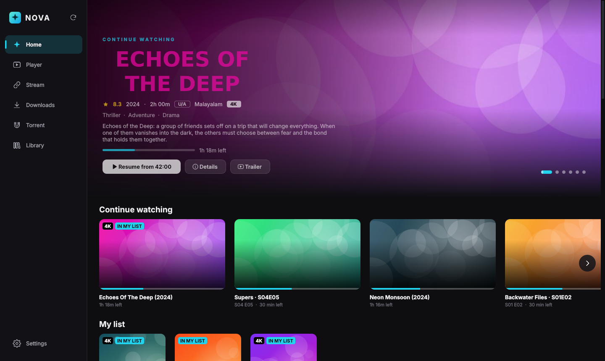
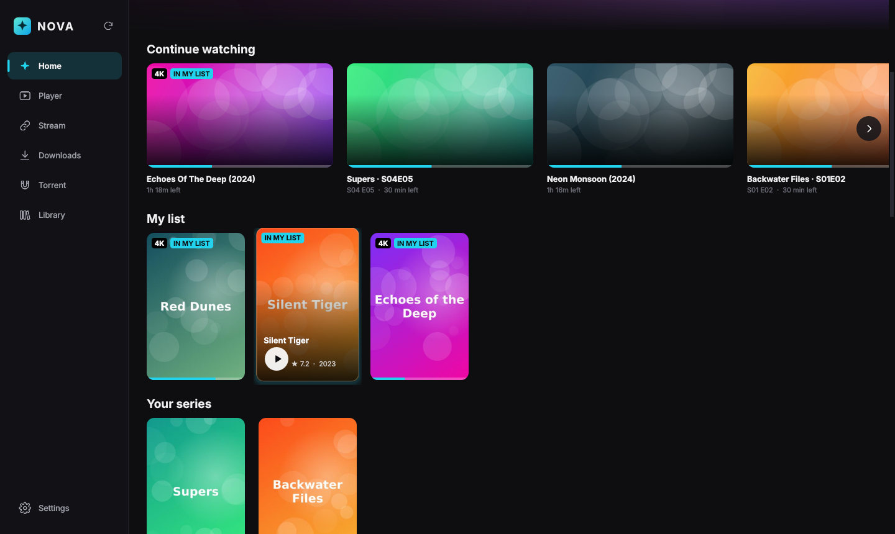
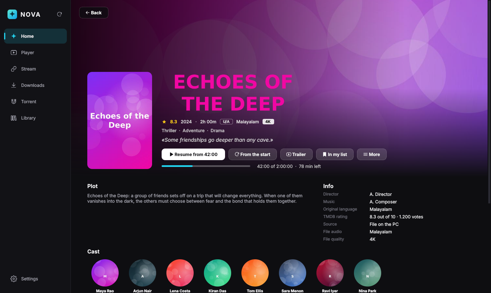
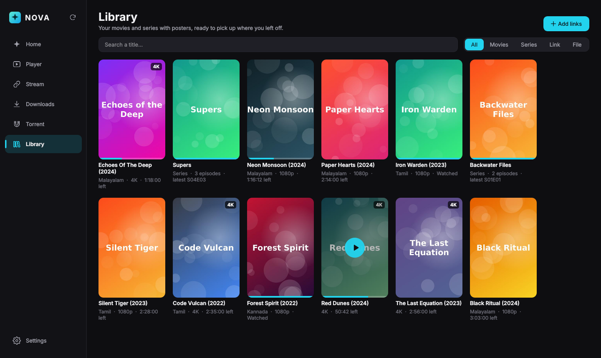
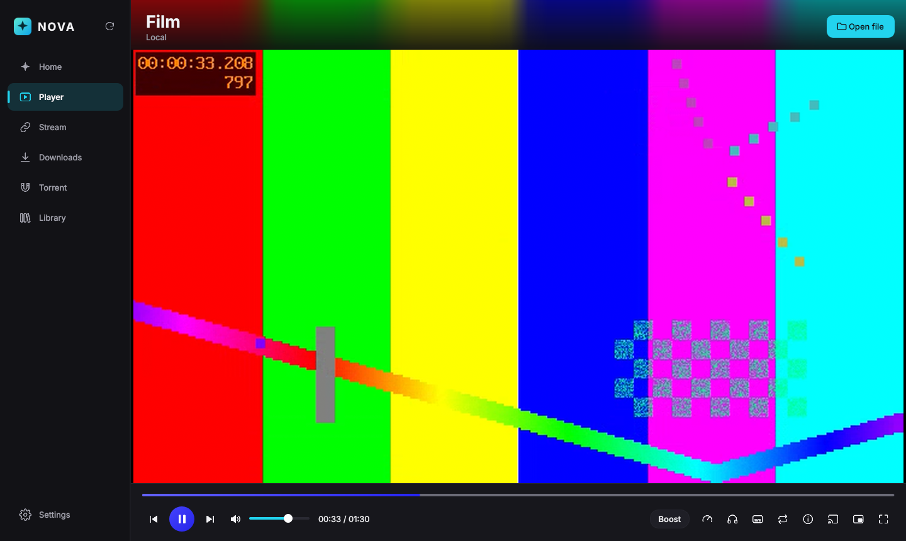

<p align="center">
  
</p>

<h1 align="center">NOVA</h1>

<p align="center">
  <b>A fast, beautiful media player for Windows — player, streaming, downloads and torrents in one app.</b><br>
  Free and open source · No ads · No tracking · Beta
</p>

<p align="center">
  <a href="../../releases/latest"></a>
  
  
</p>



## Why NOVA

NOVA is built on **mpv** (the same engine loved by video enthusiasts) with a modern interface on top:
it plays everything, starts instantly, and looks like a streaming platform — but it is *your* library.

## Features

**Player**
- Plays every format: MKV, MP4, AVI, MOV, WEBM, TS · HEVC, AV1, VP9 · DTS, TrueHD, E-AC3, FLAC
- GPU decoding (D3D11), HDR, high-quality scaling, smooth motion, RTX Video Super Resolution on small videos
- Smart resume (rewinds a few seconds so you don't lose the thread)
- **Same volume across movies** (EBU R128 loudness normalization)
- **3D "cinema in headphones"**: 5.1/7.1 becomes virtual speakers around your head
- Audio profiles: dialogue boost, night mode, subwoofer, small speakers, Indian cinema mix
- **Ctrl+F: search a sentence inside the subtitles** and jump right there
- Subtitle sync, skip intro, next episode, chapters, A-B loop, picture-in-picture, sleep timer
- "Boost" filter for low-quality videos (less blocking and noise, clearer voices)

**Home & Library (streaming-platform style)**
- Spotlight with your movies, rotating backdrops, title logos, rating, runtime, genres and trailer
- Rows: Continue watching, My list, Series, Movies, by language, by genre
- Full detail pages: plot, cast with photos, director, episodes, similar titles in your library
- Clean titles from messy file names ("Some.Movie.2024.1080p.WEB-DL.x264.mkv" → "Some Movie (2024)")

**Streaming & downloads**
- Paste a direct link and watch: **Stream Turbo** reads it with up to 16 connections (fewer stalls, instant seeking)
- Download manager (aria2): 16 connections, queue, pause/resume across restarts
- Video pages through yt-dlp, with quality choice
- Torrents (libtorrent): choose files, **watch while downloading**, fake-torrent warning
- Phone version of any video: 720p MP4 under 1.4 GB, converted on the GPU

**Living room**
- **Cast to your TV (DLNA, e.g. LG/Samsung): "the PC does everything"** — the PC decodes, burns in the subtitles and
  re-encodes on the fly; the TV only displays it. Seek and pause from NOVA or your phone; the quality adapts to your Wi-Fi.
- Phone remote: scan a QR code and control NOVA from the browser

| | |
|---|---|
|  |  |
|  |  |

## Download

Get **NOVA-Setup.exe** (or the portable zip) from the [latest release](../../releases/latest).
No admin rights needed. Windows 10/11, 64-bit.

> Windows SmartScreen may warn that the app is not recognized (the installer is not code-signed yet):
> click **More info › Run anyway**.

### Posters, cast and trailers (optional)
NOVA uses [TMDB](https://www.themoviedb.org/) for posters, plot, cast and trailers. Create a free API key
(themoviedb.org › Settings › API) and paste it in **Library**. Without it, NOVA uses frames from your own videos.

## Build from source

```bat
git clone https://github.com/puthenpurayilreison-design/nova-player
cd nova-player
setup.bat          :: creates .venv, installs Python packages and downloads mpv, ffmpeg, aria2, yt-dlp
avvia.bat          :: run NOVA
crea_exe.bat       :: build dist\NOVA\NOVA.exe and NOVA-Setup.exe (Inno Setup)
```

Requirements: Windows 10/11, Python 3.12. Every tag `v*` pushed to GitHub builds the installer automatically
(see `.github/workflows/release.yml`).

## Support the project

NOVA is free and will stay free. If you like it, a star ⭐ on GitHub helps a lot.
<!-- Donations: add your Ko-fi / crypto here -->

## Legal

NOVA is a media player and download manager. It does not provide, host or link to any content:
use it only with media you have the right to watch or download.

This product uses the TMDB API but is not endorsed or certified by TMDB.

## License & credits

NOVA is released under the **GNU GPL v3** (see [LICENSE](LICENSE)).
Built with [mpv](https://mpv.io/), [FFmpeg](https://ffmpeg.org/), [aria2](https://aria2.github.io/),
[libtorrent](https://libtorrent.org/), [yt-dlp](https://github.com/yt-dlp/yt-dlp), [Qt for Python](https://www.qt.io/qt-for-python)
and [python-mpv](https://github.com/jaseg/python-mpv). Thanks to all their authors.
